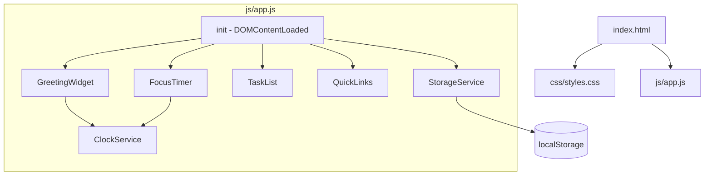

# Design Document

## Overview

The To Do List Life Dashboard is a fully client-side, single-page web application implemented with HTML, CSS, and Vanilla JavaScript. It delivers four interactive widgets on one page: a Greeting Widget that shows the current time, date, and a time-of-day message; a Focus Timer for 25-minute Pomodoro sessions; a persistent To-Do List; and a Quick Links panel of one-click URL shortcuts. All user data is stored exclusively in `localStorage` — no network requests or server dependencies exist.

The design prioritises simplicity: one HTML file, one CSS file (`css/styles.css`), and one JavaScript file (`js/app.js`). The application runs directly from a filesystem path or a simple static host, requires no build step, and is compatible with Chrome, Firefox, Edge, and Safari at their current stable releases.

---

## Architecture

The application follows a **module-per-widget** structure inside a single script file. Each widget is an isolated JavaScript object (plain object or immediately-invoked function expression) that owns its own DOM references, state, and storage keys. A thin `StorageService` module wraps `localStorage` to centralise error handling. A `ClockService` runs the shared interval that drives both the Greeting Widget and the Focus Timer.



**Key design decisions:**

- **No framework**: The constraints mandate Vanilla JS. The pattern of plain JS module objects keeps the code organised without introducing a build step or dependency.
- **Single shared clock**: Both the Greeting Widget and Focus Timer need per-second ticks. One `setInterval` at 1 000 ms fires callbacks registered by each module, eliminating timer drift between widgets.
- **Full-collection writes**: Every persistence operation writes the entire task or link array to `localStorage` as a JSON string. This keeps read/write logic simple and avoids partial-state corruption from incremental patch writes.
- **Defensive storage access**: All `localStorage` calls are wrapped in `try/catch` so that browsers with storage disabled (e.g., private-browsing restrictions) fall back gracefully rather than throwing uncaught exceptions.

---

## Components and Interfaces

### StorageService

Centralises all `localStorage` access. Every widget communicates with storage exclusively through this module.

```
StorageService
  read(key: string): any | null
    — parses JSON; returns null on parse error or quota error
  write(key: string, value: any): boolean
    — serialises to JSON; returns false on QuotaExceededError or SecurityError
  isAvailable(): boolean
    — returns true if localStorage can be read and written
```

Storage keys used:

| Key | Widget | Value type |
|---|---|---|
| `tldash_tasks` | TaskList | `Task[]` JSON array |
| `tldash_links` | QuickLinks | `Link[]` JSON array |

### ClockService

Owns the single shared `setInterval`. Other modules register tick callbacks.

```
ClockService
  start(): void
    — starts a 1 000 ms interval; fires all registered callbacks immediately
  subscribe(callback: (now: Date) => void): void
    — adds a callback to the tick list
```

### GreetingWidget

Reads the DOM elements for time, date, and greeting, then updates them on each clock tick.

```
GreetingWidget
  init(elements: { time, date, greeting }): void
  onTick(now: Date): void
    — formats time as HH:MM, date as "Day, DD Month YYYY", selects greeting string
  _selectGreeting(hour: number): string
    — returns "Good Morning" | "Good Afternoon" | "Good Evening" | "Good Night"
```

Greeting rules (from Requirement 1):

| Hours | Greeting |
|---|---|
| 05–11 | Good Morning |
| 12–17 | Good Afternoon |
| 18–20 | Good Evening |
| 21–23 and 00–04 | Good Night |

### FocusTimer

Manages timer state and button enable/disable logic.

```
FocusTimer
  INITIAL_SECONDS: 1500  (25 × 60)

  State
    remainingSeconds: number
    isRunning: boolean

  init(elements: { display, startBtn, stopBtn, resetBtn }): void
  start(): void   — registers tick callback; disables start, enables stop
  stop(): void    — removes tick callback; enables start, disables stop
  reset(): void   — calls stop(); restores remainingSeconds to 1500; updates display
  onTick(): void  — decrements remainingSeconds; updates display; calls _onExpiry if 0
  _updateDisplay(): void   — formats MM:SS; sets textContent
  _updateButtonStates(): void
  _onExpiry(): void
    — calls stop(); applies expired CSS class; plays alert sound; disables start
  _playAlert(): void   — creates and plays a short AudioContext beep (≥1 s)
```

Button enable/disable matrix:

| State | Start | Stop |
|---|---|---|
| Idle (not running, time > 0) | enabled | disabled |
| Running | disabled | enabled |
| Expired (00:00) | disabled | disabled |

### TaskList

Manages task CRUD, validation, and rendering.

```
TaskList
  MAX_DESCRIPTION_LENGTH: 200
  MAX_EDIT_LENGTH: 500
  MAX_TASKS: 100
  STORAGE_KEY: "tldash_tasks"

  State
    tasks: Task[]

  init(elements: { container, input, submitBtn, errorMsg }): void
  _loadFromStorage(): void
  _saveToStorage(): boolean   — returns false and shows error if write fails
  _renderAll(): void
  _renderTask(task: Task): HTMLElement
  addTask(description: string): void
    — validates; creates Task; appends; saves; re-renders
  editTask(id: string, newDescription: string): void
    — validates; updates in-place; saves; re-renders
  toggleComplete(id: string): void
    — flips completed flag; saves; re-renders
  deleteTask(id: string): void
    — splices from array; saves; re-renders
  _validate(text: string, maxLen: number): { valid: boolean, reason: string }
  _showError(message: string): void
  _clearError(): void
```

### QuickLinks

Manages link CRUD and rendering.

```
QuickLinks
  MAX_LINKS: 50
  MAX_LABEL_LENGTH: 50
  STORAGE_KEY: "tldash_links"

  State
    links: Link[]

  init(elements: { container, labelInput, urlInput, submitBtn, errorMsg }): void
  _loadFromStorage(): void
  _saveToStorage(): boolean
  _renderAll(): void
  _renderLink(link: Link): HTMLElement
  addLink(label: string, url: string): void
    — validates label (non-empty, ≤50 chars) and URL (http:// or https://); saves; re-renders
  deleteLink(id: string): void
    — splices; saves; re-renders
  _validateUrl(url: string): boolean
  _showError(message: string): void
  _clearError(): void
```

---

## Data Models

### Task

```js
{
  id:          string,   // crypto.randomUUID() or Date.now().toString()
  description: string,   // 1–200 chars on add; 1–500 chars on edit (trimmed)
  completed:   boolean,  // default false
  createdAt:   number    // Unix timestamp ms (Date.now())
}
```

### Link

```js
{
  id:    string,   // crypto.randomUUID() or Date.now().toString()
  label: string,   // 1–50 chars
  url:   string    // must start with "http://" or "https://"
}
```

### Storage Schema

Both collections are serialised as a JSON array and stored under their respective keys:

```
tldash_tasks → "[{\"id\":\"…\",\"description\":\"…\",\"completed\":false,\"createdAt\":…},…]"
tldash_links → "[{\"id\":\"…\",\"label\":\"…\",\"url\":\"…\"},…]"
```

On read, the application calls `JSON.parse`; any exception triggers the error/empty-state fallback described in Requirement 8.2.

---

## Correctness Properties

*A property is a characteristic or behavior that should hold true across all valid executions of a system — essentially, a formal statement about what the system should do. Properties serve as the bridge between human-readable specifications and machine-verifiable correctness guarantees.*

### Property 1: Greeting correctness for all hours

*For any* integer hour in the range 0–23, `GreetingWidget._selectGreeting(hour)` SHALL return exactly one of the four greeting strings ("Good Morning", "Good Afternoon", "Good Evening", "Good Night"), with each hour mapping to the correct greeting per the specification: hours 5–11 → Good Morning, 12–17 → Good Afternoon, 18–20 → Good Evening, 21–23 and 0–4 → Good Night.

**Validates: Requirements 1.4, 1.5, 1.6, 1.7**

### Property 2: Date format correctness

*For any* valid `Date` object, the date-formatting function SHALL return a string that matches the pattern `"Day, DD Month YYYY"` (e.g., `"Monday, 16 November 2026"`), with the correct day-of-week name, zero-padded day, full month name, and four-digit year all derived from the input date.

**Validates: Requirements 1.3**

### Property 3: Timer display format

*For any* integer value in the range 0–1500 (representing seconds remaining), `FocusTimer._updateDisplay()` SHALL produce a string in `MM:SS` format where the minutes and seconds are correctly computed from the input value and each component is zero-padded to two digits.

**Validates: Requirements 2.3**

### Property 4: Invalid task descriptions are rejected

*For any* string that is empty, composed entirely of whitespace characters, or whose length exceeds 200 characters, `TaskList.addTask(text)` SHALL leave the in-memory task array unchanged and SHALL write nothing new to Storage.

**Validates: Requirements 3.3**

### Property 5: Task addition round-trip

*For any* valid task description (a string of 1–200 characters that is not entirely whitespace), after `TaskList.addTask(description)` completes, `StorageService.read("tldash_tasks")` SHALL return an array whose last element has a `description` field equal to the trimmed input string, confirming both in-memory addition and Storage persistence.

**Validates: Requirements 3.2, 3.4, 8.3**

### Property 6: Task insertion order is preserved

*For any* sequence of up to 100 valid task additions, after all additions complete the order of tasks returned by `StorageService.read("tldash_tasks")` SHALL match the order in which the tasks were added.

**Validates: Requirements 3.6**

### Property 7: Valid edit updates task description

*For any* task in the list and any trimmed string of 1–500 characters, after `TaskList.editTask(id, text)` completes the task's `description` in both memory and Storage SHALL equal the trimmed input string.

**Validates: Requirements 4.3, 8.3**

### Property 8: Whitespace edit is rejected and original is preserved

*For any* task in the list, calling `TaskList.editTask(id, text)` with any empty or whitespace-only string SHALL leave the task's `description` in both memory and Storage unchanged from its value before the call.

**Validates: Requirements 4.4**

### Property 9: Completion toggle is a true round-trip

*For any* task in the list, calling `TaskList.toggleComplete(id)` twice in succession SHALL restore the task's `completed` field to its original value, and the JSON stored under `"tldash_tasks"` SHALL reflect that same restored value.

**Validates: Requirements 5.2, 5.3, 8.3**

### Property 10: Deleted task is absent from memory and storage

*For any* task currently in the list, after `TaskList.deleteTask(id)` completes, neither the in-memory `tasks` array nor the JSON stored under `"tldash_tasks"` SHALL contain an element with that task's `id`.

**Validates: Requirements 5.5, 8.3**

### Property 11: Invalid URL is rejected

*For any* string that does not begin with `"http://"` or `"https://"`, `QuickLinks._validateUrl(url)` SHALL return `false`, and `QuickLinks.addLink(label, url)` SHALL leave the in-memory links array and Storage unchanged.

**Validates: Requirements 6.2, 6.3**

### Property 12: Link addition round-trip

*For any* valid label (1–50 characters) and valid URL (starts with `"http://"` or `"https://"`), after `QuickLinks.addLink(label, url)` completes, `StorageService.read("tldash_links")` SHALL return an array whose last element has `label` and `url` fields equal to the submitted values.

**Validates: Requirements 6.2, 6.5, 8.4**

### Property 13: Task storage consistency over operation sequences

*For any* sequence of add, edit, complete-toggle, or delete operations applied to the task list, after each individual operation the full JSON array stored under `"tldash_tasks"` SHALL be deeply equal to the current in-memory `TaskList.tasks` array.

**Validates: Requirements 8.3**

### Property 14: Link storage consistency over operation sequences

*For any* sequence of add or delete operations applied to the links panel, after each individual operation the full JSON array stored under `"tldash_links"` SHALL be deeply equal to the current in-memory `QuickLinks.links` array.

**Validates: Requirements 8.4**

---

## Error Handling

### Storage unavailable on load

If `StorageService.isAvailable()` returns `false` on `DOMContentLoaded`, each widget initialises with an empty in-memory collection and renders a dismissible warning banner at the top of the Dashboard (Requirement 8.2). All controls remain interactive so the user can still use the application without persistence.

### Storage write failure

If `StorageService.write()` returns `false` during any add/edit/complete/delete operation:
- The operation is **not** applied to the in-memory state.
- The UI **does not** update (the rejected change is never shown).
- An inline error message appears near the relevant widget explaining that the change could not be saved.

This satisfies Requirements 3.5, 5.6, 6.3 (link deletion), 7.3, and 8.5.

### Storage read returning corrupt data

If `JSON.parse` throws when reading `tldash_tasks` or `tldash_links`, `StorageService.read()` returns `null`. Each widget treats `null` as an empty collection and shows an inline error message (Requirements 3.7, 6.8, 8.2).

### Input validation errors

Validation errors are shown as inline messages directly adjacent to the relevant input field (not modal dialogs). Error messages are cleared when the user starts typing in the associated field.

### Focus Timer audio

If the browser has not granted audio autoplay permission, `AudioContext` creation may fail. `FocusTimer._playAlert()` wraps audio creation in a `try/catch` and silently skips audio if unavailable; the visual expired state still triggers (Requirement 2.6).

### Timer state edge cases

- Calling `start()` while already running is a no-op (the start button is disabled; Requirement 2.8).
- Calling `stop()` while not running is a no-op (the stop button is disabled; Requirement 2.9).
- `reset()` is always enabled regardless of timer state.

---

## Testing Strategy

### Unit Tests

Target the pure-function and state-machine behaviour of each module. Use example-based tests for:

- `GreetingWidget._selectGreeting`: one test per boundary (0, 4, 5, 11, 12, 17, 18, 20, 21, 23).
- `TaskList._validate`: boundary inputs (empty string, single space, 200-char string, 201-char string, valid string).
- `QuickLinks._validateUrl`: valid http/https URLs, URLs missing scheme, empty string, ftp/data URLs.
- `FocusTimer` state machine: start → stop → reset sequences, expiry at 0.
- `StorageService.read`: valid JSON, malformed JSON, missing key, unavailable storage.

### Property-Based Tests

Use [fast-check](https://github.com/dubzzz/fast-check) with a minimum of 100 iterations per property test.

Each test references its design property in a comment:
> **Feature: todo-list-life-dashboard, Property {N}: {property_text}**

| Property | Generator | Assertion |
|---|---|---|
| P1: Greeting correctness | `fc.integer({ min: 0, max: 23 })` | Return value is one of the four greeting strings; hour → greeting mapping matches spec |
| P2: Date format correctness | `fc.date()` | Output matches `/^[A-Za-z]+, \d{2} [A-Za-z]+ \d{4}$/`; day/month/year values correct |
| P3: Timer display format | `fc.integer({ min: 0, max: 1500 })` | Output matches `/^\d{2}:\d{2}$/`; minutes and seconds correctly computed |
| P4: Invalid task descriptions rejected | `fc.oneof(fc.constant(""), fc.string().filter(s => s.trim() === ""), fc.string({ minLength: 201 }))` | Task array length unchanged; nothing new written to storage |
| P5: Task addition round-trip | `fc.string({ minLength: 1, maxLength: 200 }).filter(s => s.trim().length > 0)` | Storage array last element `description` equals trimmed input |
| P6: Task insertion order preserved | `fc.array(fc.string({ minLength: 1, maxLength: 200 }).filter(s => s.trim().length > 0), { maxLength: 100 })` | Storage array order matches add order |
| P7: Valid edit updates description | `fc.string({ minLength: 1, maxLength: 500 }).filter(s => s.trim().length > 0)` | In-memory and storage `description` equals trimmed input |
| P8: Whitespace edit rejected | `fc.oneof(fc.constant(""), fc.string().map(s => s.replace(/\S/g, "")))` | Task description in memory and storage unchanged |
| P9: Completion toggle round-trip | `fc.boolean()` (initial state) | Two toggles restore original `completed`; storage reflects final value |
| P10: Deleted task absent | Any existing task id | Id absent from both in-memory array and storage after delete |
| P11: Invalid URL rejected | `fc.string().filter(s => !s.startsWith("http://") && !s.startsWith("https://"))` | `_validateUrl` returns `false`; links array unchanged |
| P12: Link addition round-trip | `fc.record({ label: fc.string({ minLength: 1, maxLength: 50 }), url: fc.oneof(fc.constant("http://"), fc.constant("https://")).chain(p => fc.string({ minLength: 1 }).map(r => p + r)) })` | Storage array last element `label` and `url` equal submitted values |
| P13: Task storage consistency | Sequence of random add/edit/toggle/delete ops | Storage JSON deeply equals in-memory `tasks` after each op |
| P14: Link storage consistency | Sequence of random add/delete ops | Storage JSON deeply equals in-memory `links` after each op |

### Integration Tests

- Load the HTML page in a headless browser (e.g., Playwright or jsdom) and verify that adding a task, refreshing the page, and reading `localStorage` returns the expected task.
- Verify that setting `localStorage` to a corrupted value before load shows the error banner and renders an empty list.
- Verify responsive layout: at 320 px viewport width, no horizontal scrollbar appears and all controls are interactive.

### Manual / Cross-Browser Tests

Run a manual smoke test in Chrome, Firefox, Edge, and Safari:
- Greeting updates correctly at time-of-day boundaries.
- Focus Timer counts down accurately, plays sound at 00:00, and disables buttons per matrix.
- Tasks and links survive page refresh.
- Layout is usable at 320 px and 1 920 px viewport widths.
